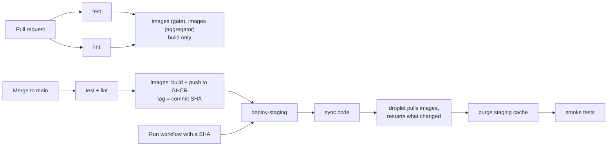

# CI/CD

One workflow, [`.github/workflows/ci.yml`](../.github/workflows/ci.yml), tests every
change and deploys `main` to staging. Images are built **once**, on GitHub, and the
servers only pull them.

## Jobs

| Job | Runs on | What it checks or does |
|---|---|---|
| `test` | every PR and push | aggregator tests (55), gate tests (34) |
| `lint` | every PR and push | shellcheck, `terraform fmt` + `validate` (both configurations), `docker compose config`, `nginx -t` for the survey and statistics configs |
| `images (gate)`, `images (aggregator)` | every PR and push | builds the images; on `main` pushes `ghcr.io/bsantoshraj/itv-{gate,aggregator}:<sha>` |
| `deploy-staging` | `main` only, after all of the above pass | syncs the repository to `/opt/itv`, runs `infra/staging/remote-deploy.sh --image-tag <sha>`, purges the staging CDN cache, runs `scripts/smoke-staging.sh` |

`main` has a ruleset ("Protect main"): no force-push or deletion, changes only by pull
request, and `test`, `lint` and both `images` checks must pass. The repository owner
can bypass it in an emergency.

## How to use it

**Normal change.** Open a PR, wait for green, merge. The staging deploy takes about
two minutes; watch it under *Actions → CI*. A red `deploy-staging` means staging
may be partly updated: read the failing step, fix forward with a new PR, or roll back.

**Roll back.** *Actions → CI → Run workflow*, branch `main`, and enter the full
40-character SHA of an earlier `main` commit (`git log --format=%H`). Tests and lint run
on the current `main`, image building is skipped, and that commit's code and images
are deployed. Images are kept in GHCR indefinitely.

**Manual deploy (fallback).** `scripts/deploy-staging.sh 134.209.157.144` from the
admin machine syncs the working tree and **builds images on the droplet** instead of
pulling them. Use it only if GitHub Actions is unavailable: builds on the droplet
have timed out downloading from PyPI.

**Smoke tests by hand.** `scripts/smoke-staging.sh` checks, through Cloudflare as a
visitor would: key pages return 200, HTTP redirects to HTTPS, the survey sends
visitors through the gate, admin routes on the public survey host return 404, the
admin host requires Cloudflare Access, statistics are less than 15 minutes old, and
the survey, gate and login pages are never cached.

**Dependency updates.** Dependabot opens weekly, grouped PRs for Python packages,
Dockerfile base images, compose images, Terraform providers and GitHub Actions.
CI tests each one; read the changelog for major versions (for example MariaDB or
LimeSurvey) before merging, and merge one at a time so a failed deploy points at one
change. Terraform provider updates also need `terraform init -upgrade` and a plan on
the admin machine (CI does not apply Terraform).

## Secrets and trust

| Name | Kind | What it is |
|---|---|---|
| `STAGING_SSH_KEY` | secret | Private key of the CI deploy key |
| `CF_PURGE_TOKEN` | secret | Cloudflare token for cache purge on `indiantaxpayervoice.org` |
| `GITHUB_TOKEN` | built in | Pushes images; passed to the droplet for one pull per deploy |
| `STAGING_HOST` | variable | Droplet IP |
| `STAGING_SSH_KNOWN_HOSTS` | variable | The droplet's SSH host keys (pinned; CI refuses any other host) |
| `CF_ZONE_ID` | variable | Cloudflare zone ID (lets the purge token work without zone read access) |

**What CI can do on the droplet.** The CI key is installed with
`command="/usr/local/bin/itv-ci-ssh-command",restrict`. It can only rsync into
`/opt/itv` (via `rrsync`) and run `deploy <40-hex sha>`; shells, PTYs, port
forwarding and paths outside `/opt/itv` are refused (all tested). The forced command
lives outside `/opt/itv`, so a code sync cannot replace it. This limits the key to the
deploy path; it does not make a compromised CI harmless, because deploying code is
running code.

**What CI never gets.** The DigitalOcean token, the Cloudflare admin token, the
backup decryption key and the application secrets (generated on each server). No
registry credential is stored on the droplet: each deploy logs in with that run's
`GITHUB_TOKEN` in a temporary Docker config and discards it.

**Not in CI (yet).** `terraform apply` (state lives on the admin machine; see
[operations.md](operations.md)), the backup restore test (needs the backup key) and
the full survey end-to-end test (it would add test responses to staging).

**Pull requests from other people.** Workflows for PRs from outside contributors wait
for the owner's approval, and PR workflows never receive secrets.

## Troubleshooting

| Symptom | Likely cause / fix |
|---|---|
| Jobs fail in 2 seconds with no steps | GitHub account billing; Actions would not start. Check *Settings → Billing* |
| `deploy-staging` fails at "Sync code" or "Deploy" with a host key error | The droplet was rebuilt: update `STAGING_SSH_KNOWN_HOSTS` (`ssh-keyscan <ip>`, verify the fingerprint) and re-run `scripts/sync-staging-keys.sh` |
| "This key may only sync code and deploy." | The workflow sent another command; the forced command refused it |
| "GHCR login failed" | The run's token lacked `packages: read`, or the image was never pushed for that SHA (rollback to a commit built before CI existed) |
| Smoke test "stats generated within 15 minutes" fails | The aggregator is failing or keeping the previous release: `docker compose logs aggregator-cron` on the droplet |
| A merge is blocked waiting for checks | Check names in the ruleset must match job names exactly (`images (gate)`, …) |
| Purge warning "CF_PURGE_TOKEN not set" | Set the secret; pages may be up to 10 minutes stale until then |
