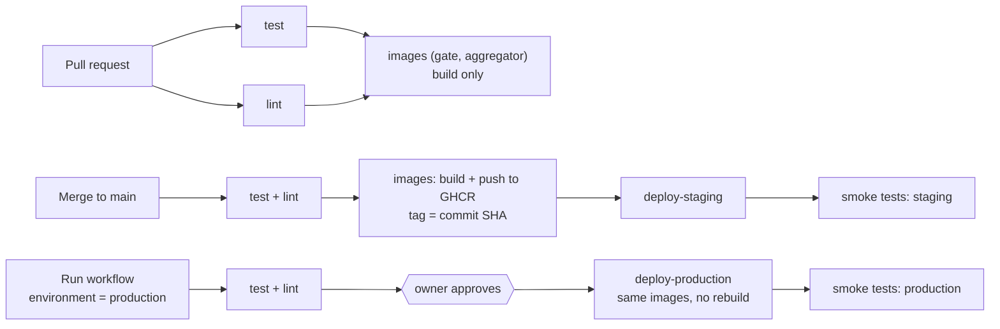

# CI/CD

One workflow, [`.github/workflows/ci.yml`](../.github/workflows/ci.yml), tests every
change, deploys `main` to **staging** automatically, and **promotes** tested images
to **production** on request, after the owner's approval. Images are built **once**,
on GitHub, and servers only pull them; production never gets a rebuild.
Every difference between the environments is listed in
[environments.md](environments.md).



## Jobs

| Job | Runs on | What it does |
|---|---|---|
| `test` | every PR, push and manual run | aggregator tests (61) and gate tests (38) |
| `lint` | same | shellcheck; `terraform fmt` + `validate` for `staging`, `production` and `cloudflare`; `docker compose config`; `nginx -t` for the survey and statistics configs |
| `images (gate)`, `images (aggregator)` | every PR and push to `main` | builds both images; on `main` pushes `ghcr.io/bsantoshraj/itv-{gate,aggregator}:<sha>`. Skipped for production runs and for redeploys of an earlier commit |
| `deploy-staging` | every push to `main`; manual runs with environment `staging` | syncs the repo, deploys that commit's images, purges the staging cache, runs `scripts/smoke.sh staging` |
| `deploy-production` | manual runs with environment `production` only | waits for approval; checks the commit is on `main` and its images exist; deploys them; purges the production cache; runs `scripts/smoke.sh production` |

`main` is protected ("Protect main" ruleset): no force-push or deletion, changes only
through pull requests, and `test`, `lint` and both `images` checks must pass. The
owner can bypass it in an emergency. PRs never deploy and never receive secrets;
workflows for PRs from outside contributors wait for the owner's approval.

## How to…

### Ship a normal change
1. Branch, commit, push, open a PR. CI runs `test`, `lint` and the image builds.
2. Merge when green. Staging deploys in about two minutes (*Actions → CI*) and its
   smoke tests must pass. A red `deploy-staging` means staging may be partly
   updated: read the failing step, then fix forward with a new PR or roll back.
3. Promote to production when ready (below). Merging alone never touches production.

### Promote to production
1. **Actions → CI → Run workflow**, branch `main`, environment **`production`**, and
   optionally a commit SHA (empty = latest `main`). From the command line:
   `gh workflow run ci.yml --ref main -f environment=production -f sha=<sha>`.
2. Open the run and click **Review deployments → production → Approve and deploy**
   (GitHub environment `production`, required reviewer: the owner). Ignore or reject
   it to cancel.
3. The job checks the commit is on `main` and that its gate and aggregator images
   exist in GHCR, deploys exactly those images, purges the production cache, runs
   the production smoke tests, and submits the page URLs to IndexNow (when
   `INDEXNOW_ID` is set; a failed submission only warns).

Only commits that were pushed to `main` have images, so production can only receive
code that has already been deployed to staging.

### Open or close the production survey (controlled release)
The gate's switch is `ITV_SURVEY_OPEN` in [`infra/env/production.env`](../infra/env/production.env)
(`1` open, `0` closed: the gate shows "The survey is not open yet" and lets nobody
through; the LimeSurvey admin keeps working).
1. PR changing the value; merge it (staging deploys; staging's own file is unaffected).
2. Promote that commit to production and approve it.
3. The production smoke tests check the expected state: the bot check when open,
   "not open yet" (503) when closed.

*History:* production went live closed on 2026-10-24 and was opened by the owner the
same day (PR #33).

### Change another per-environment setting
`infra/env/<env>.env` holds non-secret settings (`ITV_SURVEY_OPEN`, refresh interval,
rounding, minimum group size). Every deploy writes them into that droplet's `.env`;
only `ITV_*` names that do not look like secrets (`SECRET`, `PASSWORD`, `TOKEN`, `KEY`)
are accepted, otherwise the deploy fails. Secrets never go in the repository.

### Publish an article (controlled release)

Articles live in `research/articles/` (one Markdown file each, with their evidence in
`research/`). Production publishes **only the exact text that was reviewed and
published on staging**, and only with the owner's approval:

```text
 1. Write / correct    drafts doc ──export──▶ split_articles.py ──▶ research/articles/NN-*.md
 2. Review the change  PR to main (text, sources, charts, evidence files)
 3. Merge              CI deploys staging; staging syncs every article from the
                       repository as a draft, with a fingerprint (SHA-256) of its text
 4. Proofread          staging wp-admin ▶ Posts ▶ Drafts ▶ Preview (staging is private)
 5. Publish on staging the article becomes visible on the staging site (and on its
                       Research page); review it there as readers will see it
 6. Push to production "Publish to production": in the article editor's Production box,
                       or under the article in Posts (hover); shown once it is
                       published on staging
                       (itv-publish-relay starts "Publish or unpublish article");
                       GitHub asks the owner to approve (environment "production")
 7. Checks             the workflow converts the article from main and stops unless
                       staging shows it PUBLISHED with the SAME fingerprint
 8. Live               production receives the article, the CDN is purged, the URL is
                       checked (200) and search engines are notified (IndexNow)
```

- **Taking an article down:** "Unpublish from production" in the editor's Production box
  or under the article in Posts (or run the
  workflow with action `unpublish`). After approval production sets it back to draft
  (kept, not deleted), purges the CDN and checks the URL now answers 404.
- **Changed text needs a new review.** When a merge changes an article that is
  already published on staging, the next staging sync puts it **back to draft**.
  Publish it on staging again after reviewing, and step 7 will match.
- **No code deploy is needed**: the workflow carries the article to production; the
  production key's `publish` action accepts only the article named in the command.
- **Corrections** follow the same path; re-publishing updates the live article (record
  the correction in the article, as the research page promises).
- **The repository is the source of truth.** Text typed in wp-admin is replaced on the
  next sync; edit the drafts doc instead.
- **Charts** come from `research/charts/manifest.json` (article number → section heading
  → SVG). Regenerate them with the chart scripts and commit the SVGs.
- **By hand:** Actions ▶ Publish or unpublish article ▶ Run workflow (action, and slug =
  the post's slug on staging); the same checks apply. Locally:
  `research/scripts/wp_article.sh drafts`, `… publish <slug>` / `… unpublish <slug>`
  (local site only), `… status <slug>`, `… fingerprint <slug>`.

One-time setup for step 6 (the links): create a fine-grained GitHub token for this
repository only, with **Actions: read and write** and no other permission, and add it
to the staging `.env` as `ITV_PUBLISH_DISPATCH_TOKEN` (never in git). It can only
start workflows; production still waits for the owner's approval and the checks.
Without the token the links explain how to run the workflow by hand.

### Roll back
- **Staging:** Run workflow, environment `staging`, and the full SHA of an earlier
  `main` commit (`git log --format=%H`). Tests and lint run on the current `main`;
  that commit's code and images are deployed.
- **Production:** the same with environment `production`, then approve. Images stay
  in GHCR indefinitely, so any commit built since CI existed can be redeployed.

### Change the questionnaire
Each deploy compares the SHA-256 of `survey/questionnaire-v1.json` with
`ITV_LS_SURVEY_HASH` on the droplet. If they differ, **staging** replaces its survey
from the JSON (new survey ID, test responses deleted) and republishes the statistics
(`--allow-drop`). **Production refuses** and the deploy fails: a survey with real
responses needs a planned migration (export, archive, announce). Settings changed by
hand in the LimeSurvey admin are lost on replacement; put lasting changes in the JSON.

### Deploy by hand (fallback)
`IMAGE_TAG=<main sha> scripts/deploy.sh <staging|production>` from the admin machine
syncs the working tree, pulls that commit's images from GHCR with your GitHub CLI
token (not stored on the droplet), installs the origin certificate on a new droplet,
and purges the cache. Without `IMAGE_TAG` it builds images on the droplet, which is
slow and has timed out downloading from PyPI. This is also how a brand-new droplet
is first set up. Use it only when GitHub Actions is unavailable; it bypasses the
approval step.

### Run the smoke tests by hand
`scripts/smoke.sh staging` or `scripts/smoke.sh production` checks, through Cloudflare
as a visitor would:
- pages return 200 and HTTP redirects to HTTPS;
- the gate is healthy, and the survey sends visitors through it;
- the survey matches `ITV_SURVEY_OPEN`: the bot check when open, "not open yet" when closed;
- admin routes on the public survey host are refused (WAF 403 or origin 404);
- both admins require Cloudflare Access;
- the WAF blocks `/xmlrpc.php` and writes to the statistics;
- statistics are fresh (under 75 minutes; they refresh hourly);
- the survey, gate and login pages are never cached;
- **staging** is `noindex`; **production**'s website is indexable and `www` redirects.

### Review dependency updates
Dependabot opens weekly, grouped PRs (Python packages, Dockerfile base images, compose
images, Terraform providers, GitHub Actions). CI tests each one; read the changelog
for major versions (for example MariaDB 11 → 13) before merging, and merge one at a
time so a failed deploy points at one change. Terraform provider updates also need
`terraform init -upgrade` and a plan on the admin machine. Alerts for test-only tools
(`tests/responsive`) do not reach the servers.

## What a deploy does on the droplet

`infra/staging/remote-deploy.sh --image-tag <sha>`, run through the restricted CI key:

1. On a new droplet only: generate `.env` with random secrets and the environment's
   hostnames (`configure-env.sh`).
2. Apply `infra/env/<env>.env`, replace placeholder admin emails, set up host
   databases, the backup cron job and the CI forced command.
3. Log in to GHCR with the run's short-lived token (temporary Docker config,
   discarded), pull the gate and aggregator images, `docker compose up`.
4. Restart services whose bind-mounted config changed since the last deploy (nginx,
   Caddy, PHP settings), tracked in `var/deployed-config.sha256`.
5. Wait for LimeSurvey; build or replace the survey if needed (see above); sync
   LimeSurvey admin settings; run the WordPress bootstrap (pages, settings, SEO).

The survey proxy resolves the gate and LimeSurvey by name on every request (Docker
DNS), so recreated containers with new IPs are picked up without a restart.

## Secrets, variables and trust

| Name | Scope | What it is |
|---|---|---|
| `STAGING_SSH_KEY` | repository secret | Staging CI deploy key (private) |
| `STAGING_HOST`, `STAGING_SSH_KNOWN_HOSTS` | repository variables | Staging IP and pinned SSH host keys |
| `PRODUCTION_SSH_KEY` | `production` environment secret | Production CI deploy key (private), only readable by approved production runs |
| `PRODUCTION_HOST`, `PRODUCTION_SSH_KNOWN_HOSTS` | `production` environment variables | Production IP and pinned SSH host keys |
| `CF_PURGE_TOKEN` | repository secret | Cloudflare token for cache purge |
| `CF_ZONE_ID` | repository variable | Lets the purge token work without zone read access |
| `GITHUB_TOKEN` | built in | Pushes images; passed to the droplet for one pull per deploy |
| `STAGING_ACCESS_CLIENT_ID`, `STAGING_ACCESS_CLIENT_SECRET` | repository secrets | Cloudflare Access service token: staging is private, so the staging smoke tests present it (from `terraform output ci_access_tokens`) |
| `ITV_PUBLISH_DISPATCH_TOKEN` | staging `.env` only (not GitHub) | Fine-grained token, Actions read/write on this repository only: lets staging's "Publish to production" / "Unpublish from production" links start the workflow |

**What CI can do on a droplet.** Each environment has its own CI key, installed with
`command="/usr/local/bin/itv-ci-ssh-command",restrict`: it can only rsync into
`/opt/itv` (`rrsync`), run `deploy <40-hex sha>`, run `publish <article slug>` (with
that article on stdin; it refuses any other article), `status <article slug>`
(read-only) and `unpublish <article slug>`. Slugs must be lowercase letters, digits
and hyphens. Shells, PTYs, port forwarding and
paths outside `/opt/itv` are refused (tested on both droplets). The forced command
lives outside `/opt/itv`, so a code sync cannot replace it. This limits the keys to
the deploy path; it does not make a compromised CI harmless, because deploying code
is running code. The public halves are kept on the admin machine
(`~/.config/itv/ci-deploy-key[-production].pub`) and installed by
`scripts/sync-staging-keys.sh <env>`.

**What CI never gets.** The DigitalOcean token, the Cloudflare admin token, the
backup decryption key and the application secrets (generated on each droplet). No
registry credential is stored on a droplet.

**Not in CI.** `terraform apply` (state lives on the admin machine; see
[operations.md](operations.md)), the backup restore test (needs the backup key), and
the full survey end-to-end test (it would add responses).

## Troubleshooting

| Symptom | Likely cause / fix |
|---|---|
| Jobs fail in 2 seconds with no steps | GitHub account billing stopped Actions; check *Settings → Billing* |
| A run shows red but says **cancelled** | A newer push to `main` replaced a queued run; the newer run deploys both changes |
| `deploy-production` sits at **Waiting** | It needs the owner's approval: *Review deployments* on the run |
| "no gate image for <sha>" | That commit was never pushed to `main` (or predates CI); promote a `main` commit |
| "<sha> is not on main" | Only commits on `main` can be promoted |
| Host key error at "Sync code" or "Deploy" | The droplet was rebuilt: update `<ENV>_SSH_KNOWN_HOSTS` (`ssh-keyscan <ip>`, verify the fingerprint) and re-run `scripts/sync-staging-keys.sh <env>` |
| "This key may only sync code and deploy." | The workflow sent another command; the forced command refused it |
| "client_loop: send disconnect: Broken pipe" | The SSH session dropped; keepalives are on, re-run the failed job |
| "GHCR login failed" | The run's token lacked `packages: read`, or the image was never pushed for that SHA |
| "infra/env/<env>.env: refusing setting" | A non-`ITV_*` or secret-looking name was added to an env file |
| "The questionnaire changed … not replacing" | A survey change reached production; see "Change the questionnaire" |
| Survey 502/500 right after a deploy | Should not recur (names are re-resolved per request); if it does: `docker compose restart survey-proxy` on the droplet |
| A config change has no effect | The deploy restarts only services whose config checksum changed; check `var/deployed-config.sha256` and the deploy log ("Config changed for …") |
| Smoke "survey open/closed" fails | `ITV_SURVEY_OPEN` on the droplet differs from `infra/env/<env>.env`: was the commit deployed to that environment? |
| Smoke "stats generated within 75 minutes" fails | The aggregator is failing or keeping the previous release: `docker compose logs aggregator-cron` |
| A merge is blocked waiting for checks | Ruleset check names must match job names exactly (`images (gate)`, …) |
