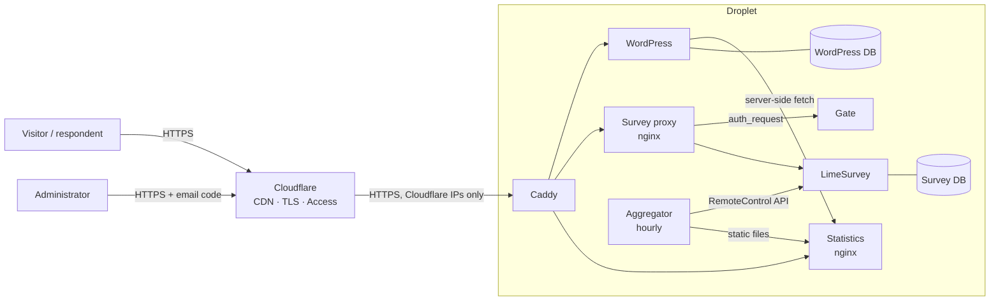

# How Indian Taxpayer Voice works

Indian Taxpayer Voice collects anonymous, voluntary survey responses from taxpayers
and publishes **aggregated, privacy-protected statistics** on a public website. This
page explains the moving parts and how a request flows through them. For the
original requirements see the private project brief (`claude.md`); for the design rationale,
costs and threat model see the [Phase 0 report](phase-0-report.md).

## The pieces

| Component | What it does | Software |
|---|---|---|
| **Website** | Public pages: mission, research, methodology, statistics, privacy, terms | WordPress 7.1 (block theme `itv`, must-use plugin `itv-stats`) |
| **Survey gate** | Bot check before anyone can open the survey; also verifies Cloudflare Access tokens for the admin | `gate/` (Python, ALTCHA proof-of-work, optional Cloudflare Turnstile) |
| **Survey proxy** | Front door of the survey: asks the gate, rate-limits submissions, refuses admin routes on the public host | nginx 1.30 |
| **Survey** | The questionnaire and its responses | LimeSurvey 7.5 (anonymised: no IP, no tokens, no dates) |
| **Aggregator** | Hourly: exports responses, validates them, suppresses small groups, rounds counts to 5, publishes static statistics | `aggregator/` (Python, standard library only) |
| **Statistics server** | Serves the published JSON/CSV files, read-only | nginx 1.30 |
| **Databases** | One for WordPress (no survey data), one for LimeSurvey | MariaDB (containers locally, host MariaDB on staging) |
| **Edge** | DNS, TLS, CDN cache, HTTP→HTTPS, admin login (Access) | Cloudflare |
| **HTTPS on the server** | Terminates TLS with a Cloudflare Origin CA certificate, routes by hostname | Caddy 2.11 (staging/production only) |

WordPress and LimeSurvey are deliberately **separate**: different databases,
different Docker networks, and WordPress has no route to the survey database. The
website only ever sees the published, already-aggregated statistics.

## Hostnames (staging)

| Hostname | Serves | Cached by Cloudflare |
|---|---|---|
| `staging.indiantaxpayervoice.org` | Website | Pages 10 min (anonymous visitors only) |
| `survey-staging.indiantaxpayervoice.org` | Survey (behind the gate) | Never |
| `survey-admin-staging.indiantaxpayervoice.org` | LimeSurvey admin (Cloudflare Access) | Never |
| `stats-staging.indiantaxpayervoice.org` | Public statistics | As the origin says (5 min) |

All are proxied by Cloudflare (SSL mode Full (strict)). The droplet's firewall accepts
HTTPS only from Cloudflare's address ranges, so none of these can be reached by IP.



## Four flows

### 1. Reading the website
Cloudflare serves cached pages to anonymous visitors (up to 10 minutes old; every
deploy purges the cache). Logged-in editors, `/wp-admin`, `/wp-login.php`, the REST
API and previews always reach WordPress. Statistics shown on pages
(`[itv_counters]`, `[itv_state_map]` tile-grid map, `[itv_states_table]`, `[itv_heatmap]` concern heat maps by sector, income, gender, age and employment, `[itv_trends]` weekly responses) are fetched **server-side** from the
statistics server and cached for 60 seconds; if they are unavailable the page says
so instead of showing a misleading zero.

### 2. Taking the survey
```mermaid
sequenceDiagram
  participant R as Respondent
  participant P as Survey proxy
  participant G as Gate
  participant L as LimeSurvey
  R->>P: GET /index.php/<survey>
  P->>G: auth_request /gate/check (pass cookie?)
  G-->>P: 401 no pass
  P-->>R: 302 to /gate/
  R->>G: solve proof-of-work in the browser (a few seconds)
  G-->>R: signed HttpOnly pass cookie (2 h, up to 60 survey requests)
  R->>P: GET /index.php/<survey> (with pass)
  P->>G: /gate/check
  G-->>P: 204 ok
  P->>L: proxied; answer POSTs rate-limited per IP
```
The gate raises the cost of automated stuffing; it does not prove a respondent is
human or unique. LimeSurvey stores no IP address, no access token and (because the
survey is anonymised) no real dates. The questionnaire (`survey/questionnaire-v1.json`)
has a consent question and 11 questions: state/UT, industry and concerns are
required; employment, income band, gender, age band, financial buffer, health
cover, priorities and a free-text comment are optional.

### 3. Turning responses into public statistics
Every hour the aggregator exports responses over LimeSurvey's RemoteControl
API, using a `stats-exporter` account that can only export this one survey. Before
anything is published:

- only **completed, consented** responses count; unknown codes are rejected;
  duplicate response IDs are counted once;
- any group smaller than **20** is suppressed (with complementary suppression so it
  cannot be worked out by subtraction);
- no response IDs, timestamps or free text ever leave the aggregator;
- CSV cells are sanitised against spreadsheet formula injection.
- published counts are rounded to the nearest 5 and percentages are whole numbers from the
  rounded figures; with hourly releases this limits working out one response by
  comparing consecutive releases (differencing).
- trends never use response times (the survey records none): each release records the day's
  published, already-rounded total in `/srv/stats/history` (not public), and the weekly trend is
  the change in that total; weeks with fewer than 20 new responses are hidden.

A run that looks wrong (missing columns, LimeSurvey unreachable, valid responses
falling by more than 10 %) **keeps the previous release**. Releases are written to a
new directory and switched atomically. Published endpoints:
`/v1/statistics/{summary,states,industries,breakdowns,distributions,trends}` (JSON)
and `/v1/statistics/states.csv`; `/` lists them.

### 4. Administering the survey
The admin lives only on `survey-admin-staging…`. Cloudflare Access emails a one-time
code to an allowed address (`hello@indiantaxpayervoice.org`; sessions last 8 hours).
The server then re-checks every request: nginx asks the gate's `/access/check`, which
verifies Cloudflare's signed token (signature, application, issuer, expiry, allowed
email). On the public survey hostname every admin route returns 404, in both
LimeSurvey URL formats. After Access you still log in to LimeSurvey itself.

## Where data lives

| Data | Where | Who can read it |
|---|---|---|
| Survey responses | LimeSurvey database on the droplet | LimeSurvey admins; the aggregator (export only) |
| Published statistics | Static files on the droplet, cached by Cloudflare | Everyone |
| Website content | WordPress database | Public pages: everyone; drafts: editors |
| Application secrets | `/opt/itv/.env` on the droplet (mode 600), generated there | The `deploy` user |
| Encrypted backups | `/var/backups/itv` (14 days) and `~/itv-backups/staging` on the admin machine | Only the holder of the backup private key |
